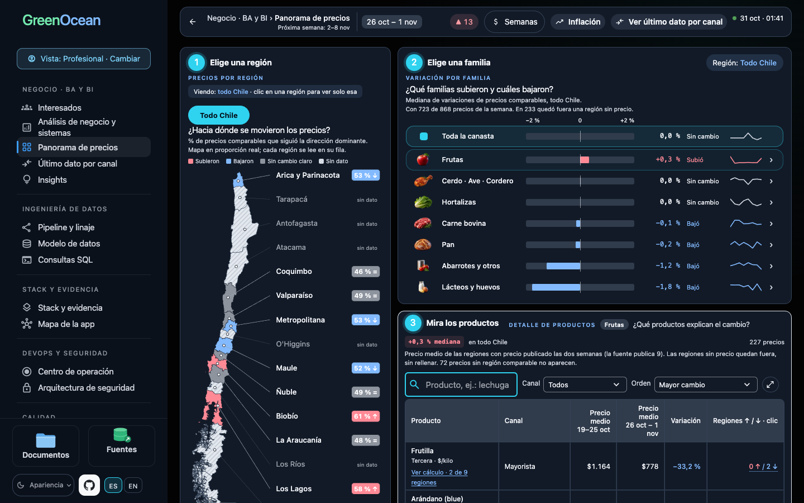
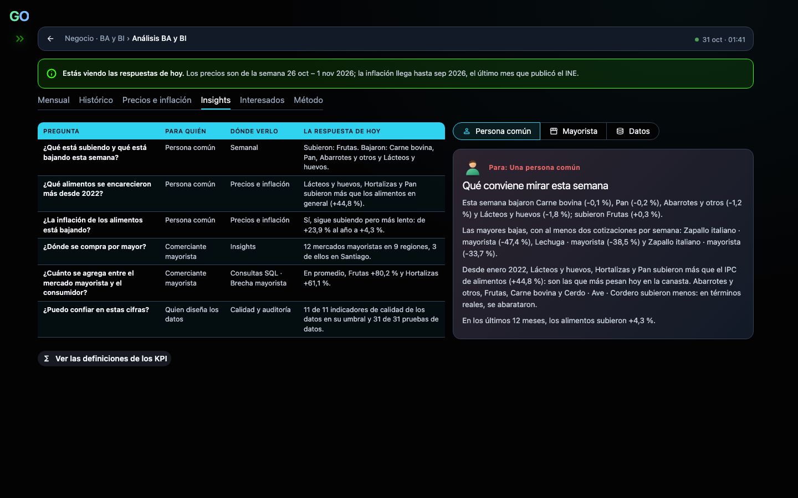
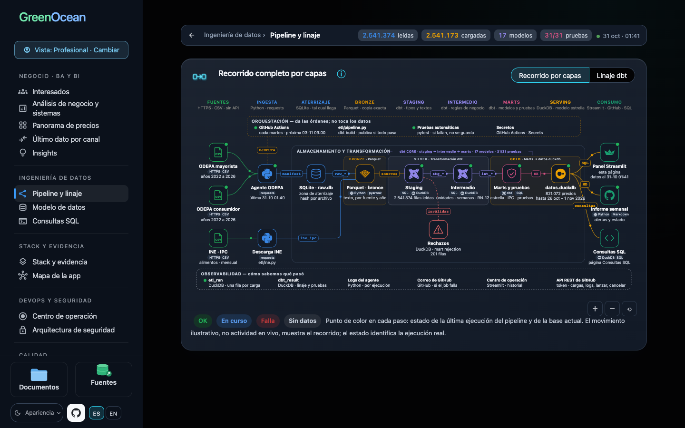
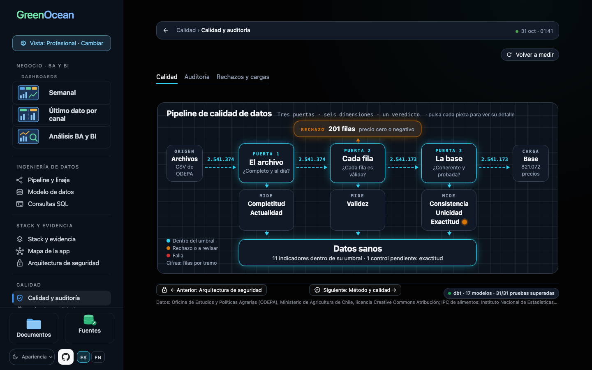
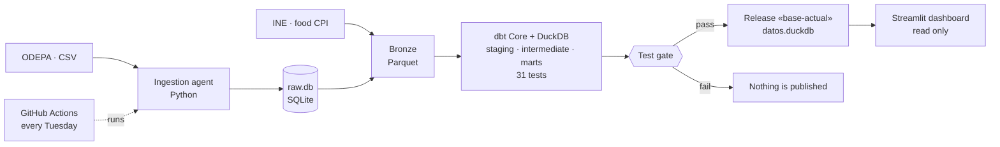

Versión en español: README.md

# GreenOcean · Chilean food price monitor

GreenOcean follows food prices in Chile every week with official data: the wholesale and consumer prices of ODEPA (the Chilean Office of Agricultural Studies and Policies) and the food CPI of INE (the national statistics institute), which shows them in real pesos.

Every Tuesday a pipeline downloads the sources, puts them in a single unit and a single week, checks their quality with 31 data tests and publishes the database only if everything passes. The dashboard lets you follow every figure back to its source file.

[**Open the public dashboard**](https://monitor-precios-hito1-d4hfucgaifcebbwahgrzwf.streamlit.app/?lang=en)

[](https://github.com/ben-carter-data/greenocean/actions/workflows/pruebas.yml)
[](https://github.com/ben-carter-data/greenocean/actions/workflows/semanal.yml)
[](https://github.com/ben-carter-data/greenocean/actions/workflows/calidad.yml)
[](docs/calidad/INFORME.md)

## Why I built it

I wanted to build an end-to-end data pipeline on a Chilean public source and show how I work, not only which tools I know. I chose food prices because they looked simple: public CSV files with clear columns. They were not, and that hidden work is exactly what the project brings into view.

I built it with an AI assistant that worked under rules written in the repository. I defined the problem, the acceptance criteria, what blocks a publication and every important decision; all of them are recorded.

## Where to start

**If you work in data engineering**, the core of the project is small:
1. [`agent/agent.py`](agent/agent.py): downloads and validates the ODEPA files.
2. [`etl/`](etl/): the landing in SQLite, the bronze layer in Parquet and [`pipeline.py`](etl/pipeline.py), which runs dbt and publishes the database only if the tests pass.
3. [`dbt/models/`](dbt/models/): the transformations in staging, intermediate and marts, with their tests.
4. [`.github/workflows/semanal.yml`](.github/workflows/semanal.yml): the automatic load of every Tuesday.

**If you work in business systems analysis (BSA)**:
1. The [PRD](docs/en/negocio/PRD.md): the problem, the stakeholders and the numbered requirements, each with the test that verifies it.
2. The [closure record](docs/en/negocio/ACTA_DE_CIERRE.md): how it started, what was expected and what the data really held.
3. The [quality plan](docs/en/calidad/PLAN_DE_CALIDAD.md) and the [failure log](docs/calidad/plan_mitigacion.json): how quality is measured and what was done each time something failed.
4. The [decision index](docs/en/arquitectura/INDICE_DECISIONES.md): the main decisions, by theme.

**If you want to see the result**, open the dashboard on the Weekly and Analysis pages.

## The dashboard

| | |
|---|---|
|  |  |
| **Weekly**: what went up and down this week, by region and by family | **Insights**, a tab of Analysis: the questions of whoever buys, sells wholesale or designs the data |
|  |  |
| **Pipeline and lineage**: the journey of the data and the state of its tests | **Data controls**: the quality gates of each load, with the rows that pass and the ones rejected |

The screenshots are of the Spanish version; add `?lang=en` to the address to read the dashboard in English. It has three views: User (the dashboards), Professional (all the technical pages) and Author (operations).

<details>
<summary>Every page of the dashboard</summary>

Pages of the dashboard, in the order of the menu: Weekly and Analysis, with its tabs Monthly, Historical, Prices and inflation, Insights, Stakeholders and Method; Pipeline and lineage, Transformation rules, Data model and SQL queries; Operations center, GitHub Actions and Settings, for the Author only; Stack and evidence, App map and Security architecture; Quality plan, Data controls and Changes and incidents; and, at the foot of the menu, the folders Project documents and Data source analysis.

</details>

## What it answers

- Which prices changed this week, and which changes are unusual?
- Is today's price normal for the season, in nominal or real pesos?
- How much more does the consumer pay over the wholesale price, by channel?

It also shows the quality of each load, with the rows read, loaded and rejected and the reason for each rejection, and lets you audit any price step by step.

## How it works

1. **Ingestion** in Python: downloads the ODEPA CSV files and the INE food CPI.
2. **Landing** in SQLite (`etl/raw.db`): ODEPA's rows exactly as they arrive.
3. **Bronze** in Parquet: a literal copy of each source, by year.
4. **Transformation** with dbt Core on DuckDB: staging, intermediate and marts, with 31 tests.
5. **Publication** of the database `etl/datos.duckdb` in the GitHub release «base-actual». The Streamlit dashboard downloads it and reads it without being able to change it.



GitHub Actions runs the load every Tuesday and the tests on every change. If a test fails, nothing is published and the dashboard keeps showing the last valid load. The [SAD](docs/en/arquitectura/SAD.md) describes the whole architecture.

## What I found in the data

- **Units are written by hand.** ODEPA uses about 200 different forms, such as «$/bandeja 18 kilos» (a tray of 18 kilos). I reviewed them one by one; the ones that cannot be read are left without a price per kilo, never with a guessed one.
- **A change of package looks like a change of price.** An alert said that kiwi in the Maule region rose 25.6 % in one week. It had in fact moved from an 18-kilo tray to a 10-kilo tray: comparing the same package, it rose 8.8 %. Since then, every change compares only the same package.
- **Sources do not always arrive on time.** When one is late, the dashboard publishes up to the last week complete in both, without filling anything in.

## Structure

```
├── agent/
│   ├── agent.py         download and validation of the ODEPA files
│   ├── input.csv        resources to download
│   ├── certs/           root certificate the connection to ODEPA needs
│   └── downloads/       the downloaded CSV files (not committed) and manifest.json, the record of each download
├── etl/
│   ├── etl.py           landing in SQLite and the datos.db backup
│   ├── bronze.py        bronze layer in Parquet
│   ├── ine.py           INE food CPI
│   ├── pipeline.py      dbt build and publication of the database
│   ├── datos.version    pointer to the database published in the «base-actual» release
│   └── raw.db, datos.duckdb, datos.db   local databases (not committed)
├── dbt/                 dbt project: staging, intermediate, marts and tests
├── bi/                  Streamlit dashboard, one file per responsibility
│   ├── dashboard.py     start, navigation and menu
│   ├── page_*.py        the pages: Weekly, Analysis, engineering, quality, DevOps and documents
│   ├── queries.sql      queries of the dashboard
│   └── static/          CSS, JavaScript and HTML of the views
├── docs/                documents in Spanish (business, architecture, quality and operations) and in English (en/)
├── notebooks/           the study of ODEPA's wholesale file, in two Jupyter notebooks
├── scripts/             quality measurement and report
├── tests/               automated tests (pytest)
└── .github/workflows/   semanal.yml, pruebas.yml and calidad.yml
```

## Quality

I measure quality in two parts: the data I publish (dbt tests, valid comparisons, rejected rows and freshness) and the code that handles it (tests and coverage, Ruff, mypy, Bandit, pip-audit and a search for secrets). Each indicator has an acceptable limit that I set.

A workflow measures the indicators on every change and, after each green load, proposes a report. The dashboard shows it on the Quality plan page only once I approve it. It is an automatic self-assessment, not an external audit. Commits follow Conventional Commits ([CONTRIBUTING](CONTRIBUTING.md)).

## Stack

Python · SQL · dbt Core · DuckDB · Parquet · SQLite · GitHub Actions · pytest · Streamlit

## Documentation

The documents exist in Spanish in [`docs/`](docs/) and in English in [`docs/en/`](docs/en/), with the same structure and figures.

| Document | Content |
|---|---|
| [PRD](docs/en/negocio/PRD.md) | The problem it solves, for whom, the questions it answers and its requirements |
| [Closure record](docs/en/negocio/ACTA_DE_CIERRE.md) | How the project started, what the data held, what was learned and whom it serves |
| [SAD](docs/en/arquitectura/SAD.md) | How it is built: the weekly load, the data with its dictionary, the deployment and the capacity |
| [ADR](docs/en/arquitectura/ADR.md) | The most important architecture decisions |
| [Test and security plan](docs/en/calidad/PLAN_PRUEBAS.md) | What is tested, who takes part in security and the attacks repeated on every change |
| [Software quality assurance plan (SQAP)](docs/en/calidad/PLAN_DE_CALIDAD.md) | What quality the project looks after, how it measures it, who decides and what happens when something fails |
| [Runbook](docs/en/operacion/MANUAL.md) | What happens every Tuesday and what to do if it fails |
| [Decision index](docs/en/arquitectura/INDICE_DECISIONES.md) | The main decisions, by theme |
| [Glossary](docs/en/negocio/GLOSARIO.md) | The acronyms and terms of the dashboard and the documents |
| [Decisions](docs/DECISIONES.md) | The full decision log, in Spanish |

## How to run it

| What for | Command |
|---|---|
| Install the dashboard and the tests | `pip install -r requirements.txt` |
| Install the pipeline with dbt (Python 3.11 or 3.12) | `pip install -r requirements-pipeline.txt` |
| Open the dashboard | `streamlit run bi/dashboard.py` |
| Run the tests | `python -m pytest -q` |
| Measure quality | `python scripts/medir_calidad.py --tools <environment>/bin` |
| Download ODEPA | `python agent/agent.py` |
| Build the data warehouse | `python etl/pipeline.py` |

## Scope and limits

- Fruit and vegetables: margin between wholesale and consumer prices. Meat, dairy, eggs, groceries and bread: consumer price only.
- ODEPA publishes 9 of the 16 regions; the national averages cover those 9.
- The real price discounts general food inflation, not each product's own.
- The indicators describe what happened; they do not predict prices or assign causes.

## Data sources

- ODEPA, Ministry of Agriculture of Chile, [open data portal](https://datos.odepa.gob.cl/), Creative Commons Attribution license.
- INE, food and non-alcoholic beverages CPI.

This project is not an official product of ODEPA or INE.

## License

The code is under the MIT license (`LICENSE`). The data keep the license of their sources.

## Author

Jocelyn Ben Yahmed
