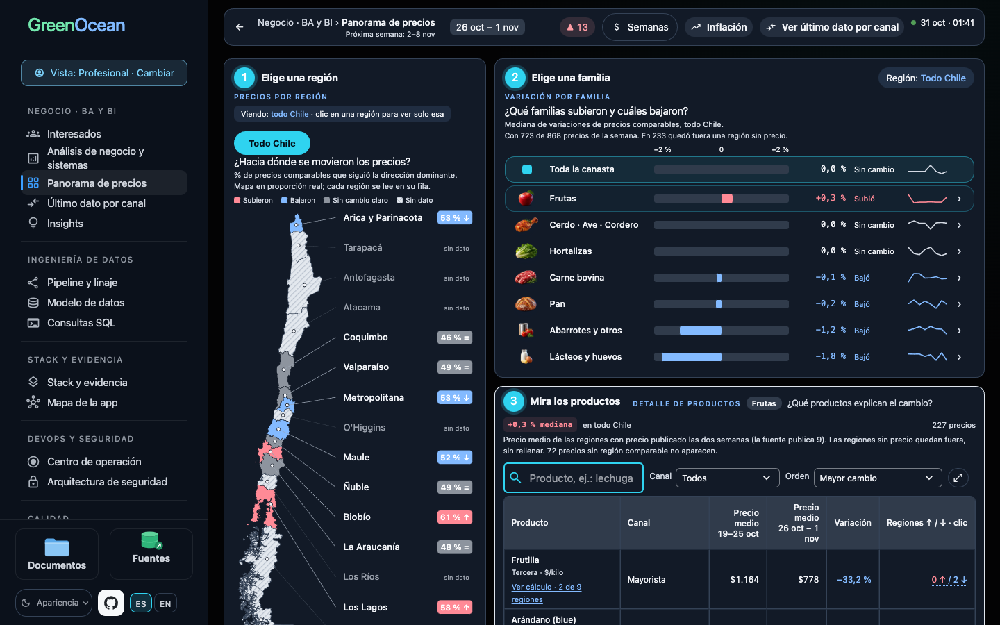
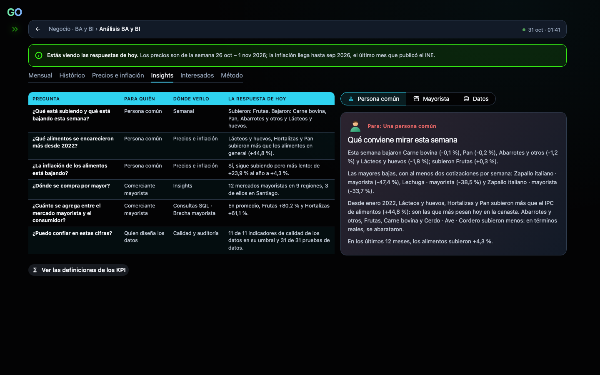
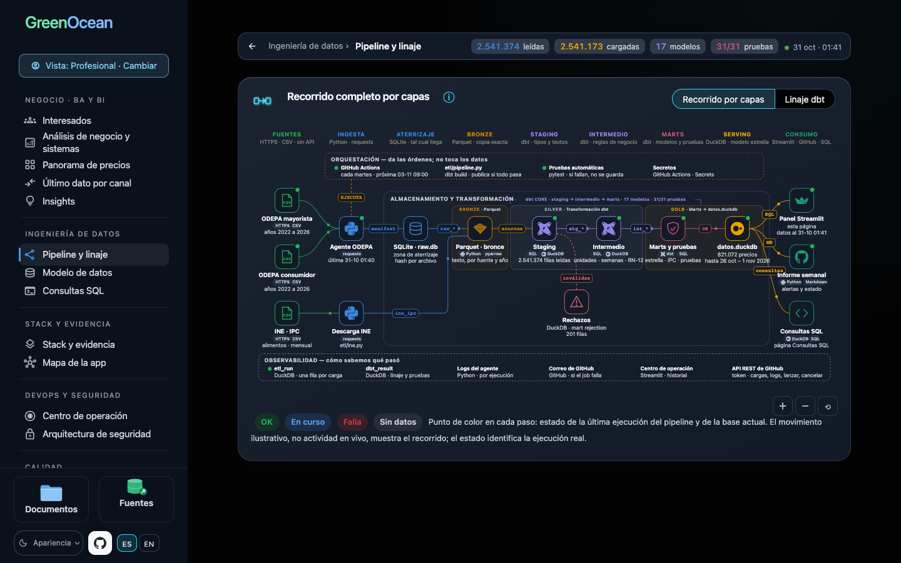
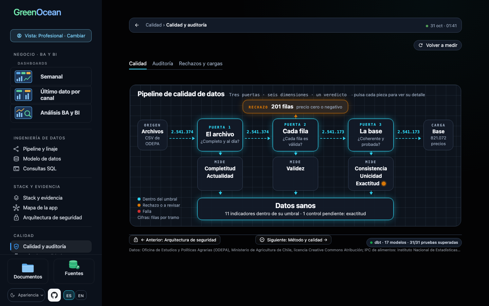
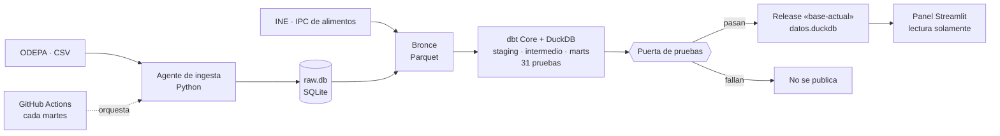

English version: README.en.md

# GreenOcean · Monitor de precios de alimentos en Chile

GreenOcean sigue cada semana los precios de los alimentos en Chile con datos oficiales: los precios mayoristas y al consumidor de ODEPA y el IPC de alimentos del INE, que permite verlos en pesos reales.

Cada martes un pipeline descarga las fuentes, las deja en una misma unidad y una misma semana, revisa su calidad con 31 pruebas de datos y publica la base solo si todo pasa. El panel permite seguir cada cifra hasta el archivo de origen.

[**Abrir el panel público**](https://monitor-precios-hito1-d4hfucgaifcebbwahgrzwf.streamlit.app/)

[](https://github.com/ben-carter-data/greenocean/actions/workflows/pruebas.yml)
[](https://github.com/ben-carter-data/greenocean/actions/workflows/semanal.yml)
[](https://github.com/ben-carter-data/greenocean/actions/workflows/calidad.yml)
[](docs/calidad/INFORME.md)

## Por qué lo hice

Quería construir un pipeline de datos de punta a punta sobre una fuente pública chilena y mostrar cómo trabajo, no solo qué herramientas conozco. Elegí los precios de alimentos porque parecían simples: archivos CSV públicos con columnas claras. No lo eran, y ese trabajo escondido es justamente lo que el proyecto deja a la vista.

Lo construí con un asistente de inteligencia artificial que trabajó bajo reglas escritas en el repositorio. Yo definí el problema, los criterios de aceptación, qué bloquea una publicación y cada decisión importante; todas quedaron registradas.

## Por dónde empezar

**Si eres de ingeniería de datos**, el corazón del proyecto es pequeño:
1. [`agent/agent.py`](agent/agent.py): descarga y valida los archivos de ODEPA.
2. [`etl/`](etl/): el aterrizaje en SQLite, la capa bronce en Parquet y [`pipeline.py`](etl/pipeline.py), que corre dbt y publica la base solo si las pruebas pasan.
3. [`dbt/models/`](dbt/models/): las transformaciones en staging, intermedio y marts, con sus pruebas.
4. [`.github/workflows/semanal.yml`](.github/workflows/semanal.yml): la carga automática de cada martes.

**Si eres de análisis de sistemas de negocio (BSA)**:
1. El [PRD](docs/negocio/PRD.md): el problema, los interesados y los requisitos numerados, cada uno con la prueba que lo verifica.
2. El [Acta de cierre](docs/negocio/ACTA_DE_CIERRE.md): cómo empezó, qué se esperaba y qué se encontró en los datos.
3. El [plan de calidad](docs/calidad/PLAN_DE_CALIDAD.md) y el [registro de fallas](docs/calidad/plan_mitigacion.json): cómo se mide la calidad y qué se hizo cada vez que algo falló.
4. El [índice de decisiones](docs/arquitectura/INDICE_DECISIONES.md): las decisiones principales, por tema.

**Si quieres ver el resultado**, abre el panel en las páginas «Semanal» y «Análisis».

## El panel

| | |
|---|---|
|  |  |
| **Semanal**: qué subió y qué bajó esta semana, por región y por familia | **Insights**, una pestaña de «Análisis»: las preguntas de quien compra, de quien vende por mayor y de quien diseña los datos |
|  |  |
| **Pipeline y linaje**: el recorrido de los datos y el estado de sus pruebas | **Controles de datos**: las puertas de calidad de cada carga, con las filas que pasan y las que se rechazan |

El panel está en español y en inglés, y tiene tres vistas: Usuario (los dashboards), Profesional (todo lo técnico) y Autor (la operación).

<details>
<summary>Todas las páginas del panel</summary>

Páginas del panel, en el orden del menú: Semanal y Análisis, con sus pestañas Mensual, Histórico, Precios e inflación, Insights, Interesados y Método; Pipeline y linaje, Reglas de transformación, Modelo de datos y Consultas SQL; Centro de operación, GitHub Actions y Configuración, solo para el Autor; Stack y evidencia, Mapa de la app y Arquitectura de seguridad; Plan de calidad, Controles de datos y Cambios e incidentes; y, al pie del menú, las carpetas Documentos del proyecto y Análisis de la fuente de datos.

</details>

## Qué responde

- ¿Qué precios cambiaron esta semana y cuáles son inusuales?
- ¿El precio de hoy es normal para la temporada, en pesos nominales o reales?
- ¿Cuánto paga el consumidor sobre el precio mayorista, por canal?

Además muestra la calidad de cada carga, con las filas leídas, cargadas y rechazadas y su motivo, y permite auditar cualquier precio paso a paso.

## Cómo funciona

1. **Ingesta** en Python: descarga los CSV de ODEPA y el IPC del INE.
2. **Aterrizaje** en SQLite (`etl/raw.db`): las filas de ODEPA tal como llegan.
3. **Bronce** en Parquet: una copia literal de cada fuente, por año.
4. **Transformación** con dbt Core sobre DuckDB: staging, intermedio y marts, con 31 pruebas.
5. **Publicación** de la base `etl/datos.duckdb` en el release «base-actual» de GitHub. El panel de Streamlit la descarga y la lee sin poder modificarla.



GitHub Actions corre la carga cada martes y las pruebas en cada cambio. Si una prueba falla, no se publica nada y el panel sigue mostrando la última carga válida. El [SAD](docs/arquitectura/SAD.md) describe la arquitectura completa.

## Lo que encontré en los datos

- **Las unidades se escriben a mano.** ODEPA usa unas 200 formas distintas, como «$/bandeja 18 kilos» o «$/kilo (en caja de 17 kilos)». Las revisé una por una; las que no se pueden leer quedan sin precio por kilo, nunca con uno adivinado.
- **Un cambio de envase parece un cambio de precio.** Una alerta marcaba que el kiwi del Maule subió 25,6 % en una semana. En realidad había pasado de bandeja de 18 kilos a bandeja de 10: comparando el mismo envase, subió 8,8 %. Desde entonces, cada variación compara solo el mismo envase.
- **Las fuentes no siempre llegan a tiempo.** Cuando una se atrasa, el panel publica hasta la última semana completa en ambas, sin rellenar nada.

## Estructura

```
├── agent/
│   ├── agent.py         descarga y validación de los archivos de ODEPA
│   ├── input.csv        recursos a descargar
│   ├── certs/           certificado raíz que necesita la conexión con ODEPA
│   └── downloads/       los CSV descargados (no se suben) y manifest.json, el registro de cada descarga
├── etl/
│   ├── etl.py           aterrizaje en SQLite y respaldo datos.db
│   ├── bronze.py        capa bronce en Parquet
│   ├── ine.py           IPC de alimentos del INE
│   ├── pipeline.py      dbt build y publicación de la base
│   ├── datos.version    puntero de la base publicada en el release «base-actual»
│   └── raw.db, datos.duckdb, datos.db   bases locales (no se suben)
├── dbt/                 proyecto dbt: staging, intermedio, marts y pruebas
├── bi/                  panel Streamlit, un archivo por responsabilidad
│   ├── dashboard.py     arranque, navegación y menú
│   ├── page_*.py        las páginas: Semanal, Análisis, ingeniería, calidad, DevOps y documentos
│   ├── queries.sql      consultas del panel
│   └── static/          CSS, JavaScript y HTML de las vistas
├── docs/                documentos en español (negocio, arquitectura, calidad y operación) y en inglés (en/)
├── notebooks/           el estudio del archivo mayorista de ODEPA, en dos cuadernos de Jupyter
├── scripts/             medición e informe de calidad
├── tests/               pruebas automáticas (pytest)
└── .github/workflows/   semanal.yml, pruebas.yml y calidad.yml
```

## Calidad

Mido la calidad en dos partes: la de los datos que publico (pruebas de dbt, comparaciones válidas, filas rechazadas y vigencia) y la del código que los trata (pruebas y cobertura, Ruff, mypy, Bandit, pip-audit y búsqueda de secretos). Cada indicador tiene un límite aceptable que yo fijé.

Un workflow mide los indicadores en cada cambio y, después de cada carga en verde, propone un informe. El panel lo muestra en la página «Plan de calidad» solo cuando lo apruebo. Es una autoevaluación automática, no una auditoría externa. Los commits siguen Conventional Commits ([CONTRIBUTING](CONTRIBUTING.md)).

## Stack

Python · SQL · dbt Core · DuckDB · Parquet · SQLite · GitHub Actions · pytest · Streamlit

## Documentación

| Documento | Contenido |
|---|---|
| [PRD](docs/negocio/PRD.md) | Qué problema resuelve, para quién, qué preguntas responde y sus requisitos |
| [Acta de cierre](docs/negocio/ACTA_DE_CIERRE.md) | Cómo empezó el proyecto, qué se encontró en los datos, qué se aprendió y a quién sirve |
| [SAD](docs/arquitectura/SAD.md) | Cómo está construido: la carga de cada semana, los datos con su diccionario, el despliegue y la capacidad |
| [ADR](docs/arquitectura/ADR.md) | Las decisiones de arquitectura más importantes |
| [Plan de pruebas y seguridad](docs/calidad/PLAN_PRUEBAS.md) | Qué se prueba, quién participa en la seguridad y los ataques que se repiten en cada cambio |
| [Plan de calidad del software (SQAP)](docs/calidad/PLAN_DE_CALIDAD.md) | Qué calidad cuida el proyecto, cómo la mide, quién decide y qué pasa cuando algo falla |
| [Manual](docs/operacion/MANUAL.md) | Qué pasa cada martes y qué hacer si falla |
| [Índice de decisiones](docs/arquitectura/INDICE_DECISIONES.md) | Las decisiones principales, por tema |
| [Glosario](docs/negocio/GLOSARIO.md) | Las siglas y los términos del panel y de los documentos |
| [Decisiones](docs/DECISIONES.md) | Registro completo de decisiones |

## Cómo ejecutarlo

| Para qué | Comando |
|---|---|
| Instalar el panel y las pruebas | `pip install -r requirements.txt` |
| Instalar el pipeline con dbt (Python 3.11 o 3.12) | `pip install -r requirements-pipeline.txt` |
| Abrir el panel | `streamlit run bi/dashboard.py` |
| Correr las pruebas | `python -m pytest -q` |
| Medir la calidad | `python scripts/medir_calidad.py --tools <entorno>/bin` |
| Descargar ODEPA | `python agent/agent.py` |
| Construir el data warehouse | `python etl/pipeline.py` |

## Alcance y límites

- Frutas y verduras: margen entre mayorista y consumidor. Carnes, lácteos, huevos, abarrotes y pan: solo precio al consumidor.
- ODEPA publica 9 de las 16 regiones; los promedios nacionales cubren esas 9.
- El precio real descuenta la inflación general de alimentos, no la de cada producto.
- Los indicadores describen lo ocurrido; no predicen precios ni atribuyen causas.

## Fuentes de los datos

- Oficina de Estudios y Políticas Agrarias (ODEPA), Ministerio de Agricultura de Chile, [portal de datos abiertos](https://datos.odepa.gob.cl/), licencia Creative Commons Atribución.
- Instituto Nacional de Estadísticas (INE), IPC de alimentos y bebidas no alcohólicas.

Este proyecto no es un producto oficial de ODEPA ni del INE.

## Licencia

El código está bajo licencia MIT (`LICENSE`). Los datos mantienen la licencia de sus fuentes.

## Autor

Jocelyn Ben Yahmed
