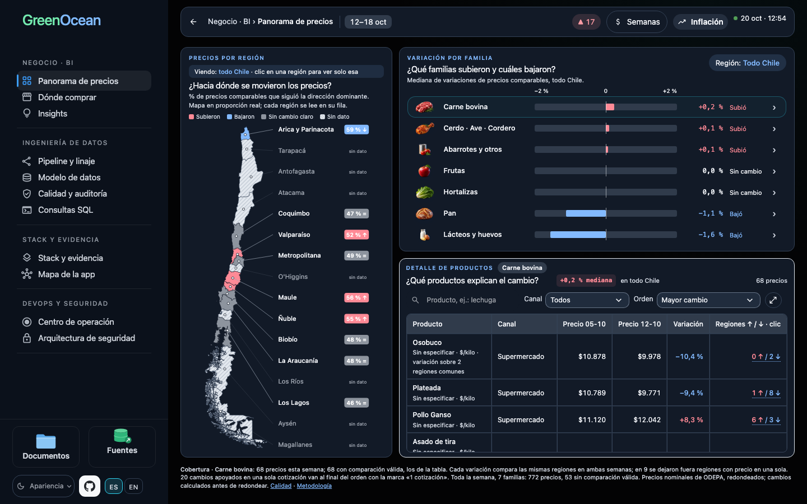
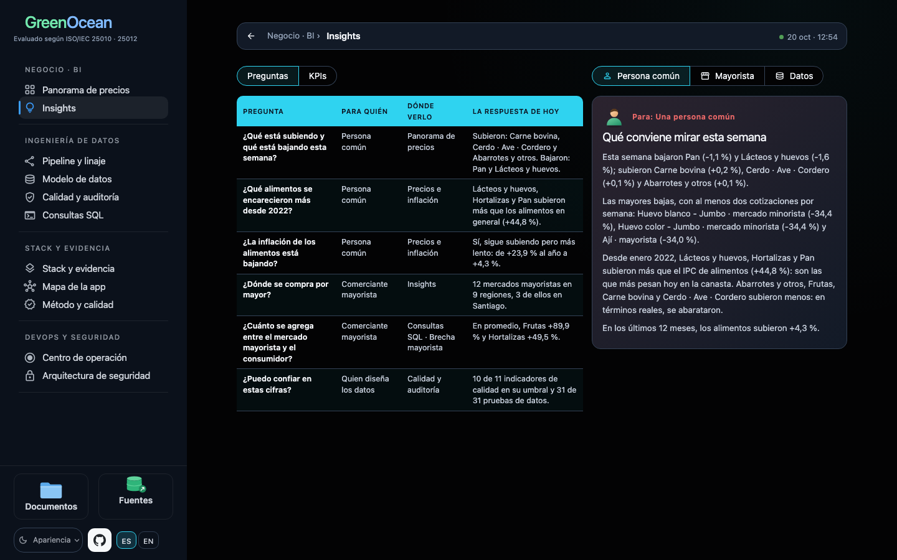
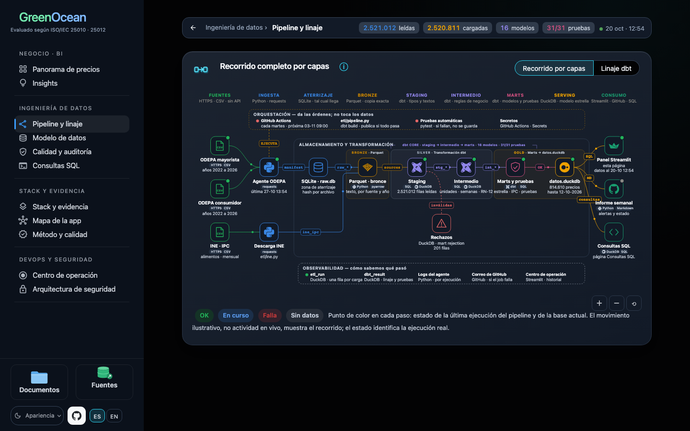
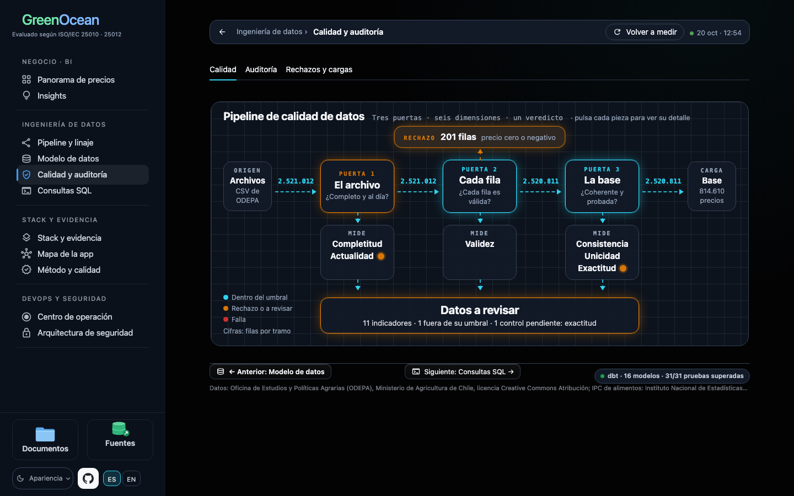
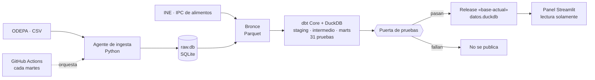

# GreenOcean · Monitor de precios de alimentos en Chile

Pipeline semanal y panel de BI sobre los precios mayoristas y al consumidor de ODEPA, con precios reales calculados con el IPC de alimentos del INE.

Cada martes el pipeline descarga las fuentes oficiales, las deja en una misma unidad y una misma semana, valida su calidad con 31 pruebas de datos y publica la base solo si todo pasa. El panel permite seguir cada cifra hasta el archivo de origen.

[**Abrir el panel público**](https://monitor-precios-hito1-d4hfucgaifcebbwahgrzwf.streamlit.app/)

[](https://github.com/ben-carter-data/greenocean/actions/workflows/pruebas.yml)
[](https://github.com/ben-carter-data/greenocean/actions/workflows/semanal.yml)
[](https://github.com/ben-carter-data/greenocean/actions/workflows/calidad.yml)
[](docs/calidad/INFORME.md)

## El panel

| | |
|---|---|
|  |  |
| **Panorama de precios**: qué subió y qué bajó esta semana, por región y por familia | **Insights**: las preguntas de quien compra, de quien vende por mayor y de quien diseña los datos |
|  |  |
| **Pipeline y linaje**: el recorrido de los datos y el estado de sus pruebas | **Calidad y auditoría**: las tres puertas de calidad de cada carga, con las filas que pasan y las que se rechazan |

Páginas del panel: Panorama de precios, Insights y Precios e inflación (desde un botón del Panorama), Pipeline y linaje, Modelo de datos, Calidad y auditoría, Consultas SQL, Centro de operación, Arquitectura de seguridad, Stack y evidencia, Método y calidad, Mapa de la app y la carpeta de documentos. Está en español y en inglés.

## Qué responde

- ¿Qué precios cambiaron esta semana y cuáles son inusuales?
- ¿El precio de hoy es normal para la temporada, en pesos nominales o reales?
- ¿Cuánto paga el consumidor sobre el precio mayorista, por canal?

Además muestra la calidad de cada carga (filas leídas, cargadas y rechazadas con su motivo) y permite auditar cualquier precio paso a paso.

## Cómo funciona

1. **Ingesta** en Python: descarga los CSV de ODEPA y el IPC del INE.
2. **Aterrizaje** en SQLite (`etl/raw.db`): las filas de ODEPA tal como llegan.
3. **Bronce** en Parquet: copia literal de cada fuente, por año; el IPC llega aquí directo.
4. **Transformación** con dbt Core sobre DuckDB: staging, intermedio y marts, con 31 pruebas.
5. **Publicación** de `etl/datos.duckdb` en el release «base-actual» de GitHub, que cada carga reemplaza; el panel de Streamlit la descarga y la lee en solo lectura.



GitHub Actions ejecuta todo cada martes y corre las pruebas en cada cambio. Los diagramas completos (pipeline y linaje, modelo estrella, despliegue, CI/CD, monitoreo y arquitectura de seguridad) están en el panel; el [SAD](docs/SAD.md) describe la arquitectura por vistas y enlaza a ellos.

## Estructura

```
├── agent/
│   ├── agent.py         descarga y validación de los archivos de ODEPA
│   └── input.csv        recursos a descargar
├── etl/
│   ├── etl.py           aterrizaje en SQLite y respaldo datos.db
│   ├── raw.db           aterrizaje de ODEPA (no se sube; lo genera la ingesta)
│   ├── bronze.py        capa bronce en Parquet
│   ├── ine.py           IPC de alimentos del INE
│   ├── pipeline.py      dbt build y publicación de la base
│   ├── datos.version    puntero de la base servida (la base vive en el release «base-actual»)
│   ├── datos.duckdb     base servida (no se sube; python bi/served_database.py la descarga)
│   └── datos.db         respaldo en SQLite (no se sube; lo rehace cada carga)
├── dbt/                 proyecto dbt: staging, intermedio, marts y pruebas
├── bi/
│   ├── dashboard.py     panel Streamlit
│   ├── queries.sql      consultas del panel
│   └── architecture.py  diagramas en vivo del pipeline y la plataforma
│   (y el resto del panel: páginas, diagramas, textos en español e inglés)
├── docs/                PRD, SAD, ADR, plan de pruebas y seguridad, decisiones y manual
│   ├── en/              los mismos documentos en inglés
│   ├── img/             capturas del panel
│   ├── calidad/         medición de calidad, metas, rúbrica ISO, historial e informe
│   └── archivo/         historia del proyecto (hitos y backlog); no es lectura
├── scripts/             medición e informe de calidad, y la descarga con doble clic en macOS
├── tests/               pruebas automáticas (pytest) y sus datos en fixtures/
└── .github/workflows/   semanal.yml, pruebas.yml y calidad.yml
```

## Calidad

La página «Método y calidad» y el [informe de autoevaluación](docs/calidad/INFORME.md) miden el proyecto con herramientas reales (Ruff, mypy, pytest con cobertura, Bandit, pip-audit, detect-secrets, Playwright y axe-core) contra metas fijas, y lo evalúan con la ISO/IEC 25010 y 25012 como método: es una autoevaluación, no una certificación. El workflow «calidad» repite la medición en cada push y la propone en un pull request; la página la muestra solo cuando el autor lo fusiona. La insignia de cobertura lee esa medición aprobada. Los commits siguen Conventional Commits ([CONTRIBUTING](CONTRIBUTING.md)).

## Stack

Python · SQL · dbt Core · DuckDB · Parquet · SQLite · GitHub Actions · pytest · Streamlit

## Documentación

| Documento | Contenido |
|---|---|
| [PRD](docs/PRD.md) | Qué problema resuelve, para quién, qué preguntas responde y sus requisitos |
| [SAD](docs/SAD.md) | Cómo está construido: la carga de cada semana, los datos con su diccionario, el despliegue y la capacidad |
| [ADR](docs/ADR.md) | Las decisiones de arquitectura más importantes |
| [Plan de pruebas y seguridad](docs/PLAN_PRUEBAS.md) | Qué se prueba, quién participa en la seguridad y los ataques que se repiten en cada cambio |
| [Manual](docs/MANUAL.md) | Qué pasa cada martes y qué hacer si falla |
| [Índice de decisiones](docs/INDICE_DECISIONES.md) | Las decisiones principales, por tema |
| [Glosario](docs/GLOSARIO.md) | Las siglas y los términos del panel y de los documentos |
| [Decisiones](docs/DECISIONES.md) | Registro completo de decisiones |

## Cómo ejecutarlo

| Para qué | Comando |
|---|---|
| Instalar el panel y las pruebas | `pip install -r requirements.txt` |
| Instalar el pipeline con dbt (Python 3.11 o 3.12) | `pip install -r requirements-pipeline.txt` |
| Abrir el panel | `streamlit run bi/dashboard.py` |
| Correr las pruebas | `python -m pytest -q` |
| Medir la calidad | `python scripts/medir_calidad.py --tools <entorno>/bin` |
| Descargar ODEPA | `python agent/agent.py` |
| Construir el data warehouse | `python etl/pipeline.py` |

## Alcance y límites

- Frutas y verduras: margen entre mayorista y consumidor. Carnes, lácteos, huevos, abarrotes y pan: solo precio al consumidor.
- ODEPA publica 9 de las 16 regiones; los promedios nacionales cubren esas 9.
- El precio real descuenta la inflación general de alimentos, no la de cada producto.
- Los indicadores describen lo ocurrido; no predicen precios ni atribuyen causas.

## Fuentes de los datos

- Oficina de Estudios y Políticas Agrarias (ODEPA), Ministerio de Agricultura de Chile, [portal de datos abiertos](https://datos.odepa.gob.cl/), licencia Creative Commons Atribución.
- Instituto Nacional de Estadísticas (INE), IPC de alimentos y bebidas no alcohólicas.

Este proyecto no es un producto oficial de ODEPA ni del INE.

## Licencia

El código está bajo licencia MIT (`LICENSE`). Los datos mantienen la licencia de sus fuentes.

## Autor

Jocelyn Ben Yahmed
