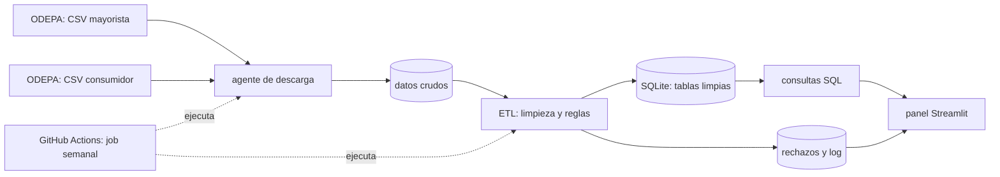
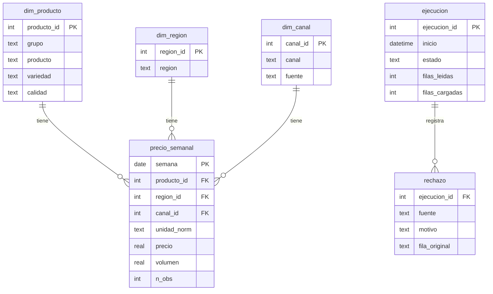
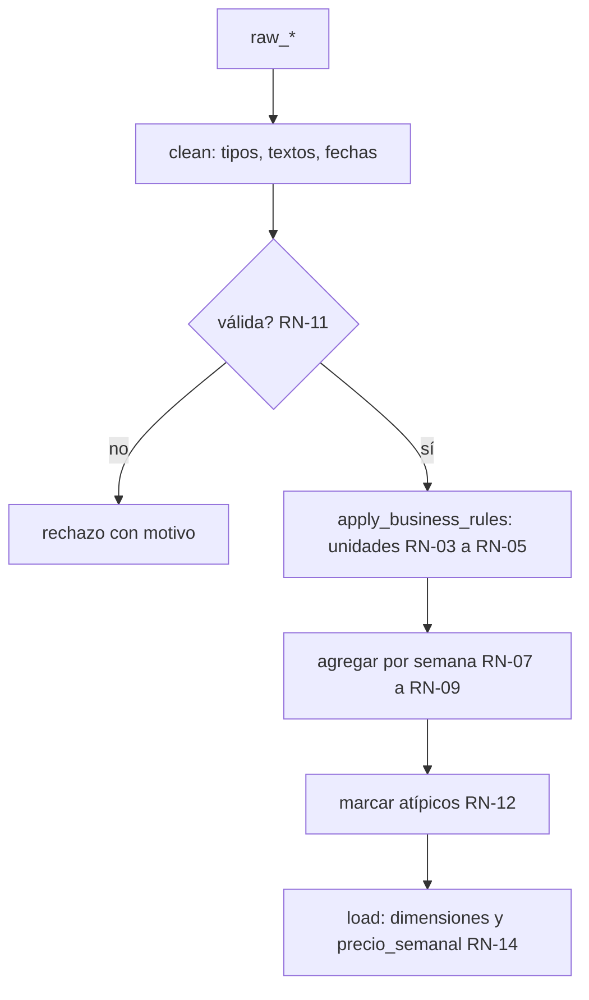

# Monitor de precios y márgenes de la cadena alimentaria en Chile

**Documento de diseño (PRD + arquitectura)** · versión 0.2 · 11-10-2026 · Autor: Jocelyn Ben Yahmed

Este documento basta para construir el producto: quien lo lea (una persona, un equipo o un asistente de IA) no debería necesitar preguntar nada más. Lo acompañan `README.md`, `BACKLOG.md` y `DECISIONES.md`.

---

## 1. Resumen

Sistema automatizado que descarga cada semana dos conjuntos de datos públicos de ODEPA (precios mayoristas y precios al consumidor), los limpia, aplica reglas de negocio, los carga en una base de datos y publica un panel con indicadores de margen, diferencias por canal y región, estacionalidad y alertas.

## 2. Problema y usuario

Un analista de pricing, compras o abastecimiento (supermercado, distribuidora, empresa de alimentos) que quiera seguir estos precios hoy debe bajar archivos de dos fuentes, convertir unidades distintas y cruzarlos a mano cada semana. Las fuentes existen, pero están separadas y no son comparables entre sí sin trabajo previo.

### Perfiles de usuario

| Perfil | Necesita | Vistas | Prioridad |
|---|---|---|---|
| Analista de pricing / compras | Márgenes, diferencias por canal y región, alertas | Márgenes, Canales y regiones, Estacionalidad | 1 |
| Equipo de datos | Saber si la carga funcionó y qué se descartó | Calidad de datos | 1 |
| Gerencia | Pocos indicadores y tendencias | Resumen ejecutivo | 2 |
| Consumidor | Dónde y cuándo conviene comprar | Vista simple por producto | 3 |

El panel abre con un selector «¿Quién consulta?». No hay inicio de sesión ni datos personales.

## 3. Preguntas de negocio

| # | Pregunta | Aplica a |
|---|---|---|
| P1 | ¿Cuál es el margen entre precio mayorista y precio al consumidor, y cómo evoluciona? | Frutas y verduras |
| P2 | ¿Cuánto difiere el precio entre canales (supermercado, feria, carnicería, etc.)? | Todos los grupos |
| P3 | ¿En qué regiones son más altos los precios y los márgenes? | Todos los grupos |
| P4 | ¿En qué semanas sube y baja cada producto, y cuánto? | Todos los grupos |
| P5 | ¿Con cuántas semanas de diferencia sigue el precio al consumidor al mayorista? (descriptivo) | Frutas y verduras |
| P6 | ¿Qué productos se movieron esta semana fuera de su rango normal? | Todos los grupos |

## 4. Alcance

**Incluye (etapa 1)**

- Dos fuentes de ODEPA, años 2022 a 2026 (propuesta; ver D-009).
- Nivel 1: 41 frutas y verduras presentes en ambas fuentes, con todas las preguntas.
- Nivel 2: carnes, lácteos, huevos, abarrotes y pan (solo fuente consumidor), con P2, P3, P4 y P6.
- Ejecución semanal automática y panel público.

**No incluye**

- Scraping de sitios web.
- Pescados y mariscos (no están en las fuentes).
- Modelos estadísticos o predicción. P5 es un indicador descriptivo, no prueba causalidad.
- Ajuste por inflación (queda en backlog; en etapa 1 los precios son nominales).
- Comercio exterior (etapa 2).

## 5. Fuentes

Ambas del portal de datos abiertos de ODEPA, licencia Creative Commons Atribución. Un archivo CSV por año, UTF-8 con BOM, separador coma, decimales con coma.

### 5.1 Precios mayoristas de frutas y hortalizas

- Página: `https://datos.odepa.gob.cl/dataset/precios-mayoristas-de-frutas-y-hortalizas`
- Frecuencia: diaria (días hábiles). Años: 1994 a 2026.
- Archivo 2026 revisado: 145.231 filas, 12 mercados, 80 productos, 9 regiones.

| Columna | Tipo | Nota |
|---|---|---|
| Fecha | fecha | AAAA-MM-DD |
| ID region, Region | entero, texto | |
| Mercado | texto | Lo Valledor, Vega Central, etc. |
| Subsector | texto | Frutas / Hortalizas y tubérculos |
| Producto | texto | 80 valores |
| Variedad / Tipo | texto | 199 valores |
| Calidad | texto | 55 valores |
| Unidad de comercializacion | texto | 147 valores, p. ej. `$/caja 25 kilos` |
| Origen | texto | provincia o región de procedencia |
| Volumen | entero | en la unidad de comercialización |
| Precio minimo, maximo, promedio | texto | decimal con coma |

### 5.2 Precios al consumidor

- Página: `https://datos.odepa.gob.cl/dataset/precios-consumidor`
- Frecuencia: semanal. Años: 2008 a 2026.
- Archivo 2026 revisado: 252.583 filas, 266 productos, 9 regiones, 7 tipos de punto de venta.

| Columna | Tipo | Nota |
|---|---|---|
| Anio, Mes, Semana | entero | |
| Fecha inicio, Fecha termino | fecha | lunes a viernes de la semana |
| ID region, Region, Sector | entero, texto, texto | Sector = ciudad o comuna |
| Tipo de punto monitoreo | texto | Supermercado, Feria libre, Carnicería, Panadería, Mercado Minorista, Mercado Mayorista, Supermercado en Línea |
| Grupo | texto | 7 grupos |
| Producto | texto | en frutas y verduras: `Producto\|Variedad\|Calidad` |
| Unidad | texto | 19 valores; `$/kilo` y `$/unidad` en frutas y verduras |
| Precio minimo, maximo, promedio | entero, entero, texto | promedio con coma decimal |

### 5.3 Clave de cruce

`Producto + Variedad + Calidad + ID region + semana (lunes de inicio)`.

En el archivo 2026, 146 de las 168 claves de frutas y verduras del consumidor existen de forma exacta en el mayorista.

## 6. Reglas de negocio

| ID | Regla |
|---|---|
| RN-01 | Convertir precios de texto con coma decimal a número. |
| RN-02 | Separar `Producto` del consumidor en producto, variedad y calidad usando `\|`. Si no trae `\|`, variedad y calidad quedan como «Sin especificar». |
| RN-03 | Unidad mayorista a kilo: si la unidad declara kilos (`$/caja 25 kilos`), precio por kilo = precio / kilos. `$/kilo` se deja igual. |
| RN-04 | Unidad mayorista a unidad: si declara unidades (`$/caja 15 unidades`), precio por unidad = precio / unidades. `$/unidad` se deja igual. |
| RN-05 | Unidades con rango o sin cantidad (`$/atado 1,5 a 2 kilos`, `$/docena de atados`) no se convierten: la fila se conserva sin precio normalizado y con motivo `UNIDAD_NO_CONVERTIBLE`. |
| RN-06 | El margen solo se calcula cuando mayorista y consumidor están en la misma unidad normalizada (kilo con kilo, unidad con unidad). |
| RN-07 | Precio mayorista semanal = promedio ponderado por volumen de los precios diarios de la semana, por región y clave de producto. |
| RN-08 | Semana = lunes de inicio. La fecha mayorista se asigna a su lunes; debe coincidir con `Fecha inicio` del consumidor. |
| RN-09 | Precio al consumidor semanal = promedio de `Precio promedio` por región, canal y clave de producto. |
| RN-10 | El punto de venta «Mercado Mayorista» del archivo de consumidor se trata como un canal más; no reemplaza a la fuente mayorista. |
| RN-11 | Validación: precio ≤ 0, mínimo > máximo o fecha fuera del año del archivo → fila rechazada con motivo. Nunca se borra en silencio. |
| RN-12 | Valor atípico: precio normalizado mayor a 5 veces o menor a 1/5 de la mediana del producto en esa semana → se marca `ATIPICO` y se excluye de los indicadores, pero se conserva. |
| RN-13 | Normalizar textos: quitar espacios duplicados y espacios no separables; no cambiar mayúsculas del valor original. |
| RN-14 | Carga idempotente: volver a ejecutar la misma semana no duplica filas. |

Los umbrales de RN-12 son iniciales y se ajustan con los datos (ver backlog).

Precisiones tomadas al construir el hito 2, registradas en `DECISIONES.md`: RN-03 a RN-05 se aplican a las dos fuentes y también convierten gramos a kilo y ml a litro (D-026); en RN-11 una semana pertenece al archivo si toca su año (D-025); la mediana de RN-12 se calcula dentro de cada fuente (D-028).

## 7. Indicadores

| ID | Indicador | Fórmula | Pregunta |
|---|---|---|---|
| K1 | Margen mayorista-consumidor (%) | (P_consumidor − P_mayorista) / P_mayorista | P1 |
| K2 | Diferencial entre canales (%) | P_canal_A / P_canal_B − 1 | P2 |
| K3 | Índice regional | P_región / P_promedio_nacional | P3 |
| K4 | Índice estacional | P_semana / P_promedio_anual del producto | P4 |
| K5 | Rezago (semanas) | desfase entre 0 y 8 semanas con mayor correlación entre las variaciones semanales de ambos precios | P5 |
| K6 | Alerta de variación | variación semanal fuera de ±2 desviaciones estándar de las últimas 12 semanas | P6 |
| K7 | Cobertura del cruce (%) | claves con margen calculado / claves de frutas y verduras del consumidor | calidad |
| K8 | Filas rechazadas (%) | filas rechazadas / filas leídas, por motivo | calidad |

K1 se calcula por canal (feria, supermercado). K5 se muestra solo con al menos 26 semanas de datos del producto.

## 8. Arquitectura

### 8.1 Componentes

| Componente | Archivo | Responsabilidad |
|---|---|---|
| Agente de descarga | `agent/agent.py` | Descargar los CSV del año en curso (y los históricos la primera vez), validar y registrar. |
| ETL | `etl/etl.py` | `clean()`, `apply_business_rules()`, `load()`. |
| Esquema | `etl/schema.sql` | Definición de tablas. |
| Consultas | `bi/queries.sql` | Una consulta por indicador. |
| Panel | `bi/dashboard.py` | Selector de perfil y vistas. |
| Job | `.github/workflows/semanal.yml` | Ejecutar agente y ETL cada semana y guardar la base. |
| Pruebas | `.github/workflows/pruebas.yml` | Ejecutar `pytest` en cada cambio. |
| Informe | `bi/report.py` | Generar el resumen semanal de alertas y estado, que el job publica como issue. |
| Alertas | `bi/alerts.py` | Calcular K6 a partir de la serie semanal. |
| Acceso a datos | `bi/queries.py` | Leer `queries.sql` y ejecutar una consulta por nombre. |

### 8.2 Agente de descarga

Mismo orden de funciones que un agente de descarga tradicional:

1. Variables al inicio: URL de cada recurso, columnas esperadas, umbrales de reintento.
2. `load_input_resources()`: lee la lista de recursos a descargar (fuente, año, URL).
3. `download_all_resources()`: recorre la lista y controla reintentos y fallas.
4. `download_file()`: descarga a un archivo temporal.
5. `validate_downloaded_file()`: tamaño mayor que cero, encabezado igual al esperado, al menos una fila.
6. Funciones de log: descargado, sin cambios, falla, encabezado inesperado.

Comportamiento:

- No vuelve a descargar un año cerrado que ya existe.
- El año en curso se descarga siempre y se compara con el anterior (hash) para saber si hubo cambios.
- Cada intento fallido suma una advertencia; al superar el umbral se registra una falla y el job termina con error, sin cargar datos parciales.
- Si el encabezado cambió, no se carga nada y se registra `UNEXPECTED_HEADER`.

### 8.3 Modelo de datos

- `dim_canal` incluye «Mayorista» (fuente mayorista) y los 7 puntos de venta del consumidor. Así el margen es una comparación entre dos canales de la misma tabla.
- Tablas crudas `raw_wholesale` y `raw_consumer` guardan los archivos tal como vienen, con el año y el hash del archivo. Viven en `raw.db`, fuera del repositorio (D-020).
- `unidad_norm` es `kilo`, `unidad`, `litro` o nulo (RN-05, D-026).
- En la base las tablas y columnas tienen nombres en inglés (D-023); la equivalencia está en `docs/hito-2.md`.

### 8.4 Flujo ETL

## 9. Stack y operación

| Capa | Herramienta | Costo |
|---|---|---|
| Lenguaje | Python 3.11+ (pandas, requests) | gratis |
| Base de datos | SQLite: `raw.db` (se reconstruye en cada ejecución, no se sube) y `datos.db` (indicadores semanales, en el repositorio) | gratis |
| Panel | Streamlit | gratis |
| Ejecución programada | GitHub Actions (cron semanal) | gratis en repositorio público |
| Publicación del panel | Streamlit Community Cloud | gratis |
| Control de versiones | Git + GitHub, repositorio público | gratis |
| Pruebas | pytest | gratis |

El job corre los martes (los datos de consumidor de la semana se publican al cierre de la anterior; el día exacto se ajusta observando el portal). Después de cada ejecución el job guarda la base actualizada en el repositorio y el panel la lee desde ahí.

Alternativa documentada, no implementada: mover la base a un PostgreSQL gestionado gratuito si el tamaño o la concurrencia lo exigen.

## 10. Viabilidad y riesgos

**Verificado con los archivos 2026**

- Descarga directa disponible, licencia que permite reutilizar citando la fuente.
- 41 productos en ambas fuentes; 146 claves exactas.
- Prueba con 5 productos (tomate, papa, limón, palta, cebolla) en la Región Metropolitana: cruce en las 41 semanas disponibles.
- 69 % de las filas mayoristas se convierte a kilo con RN-03.

**Medido en el hito 2 con los archivos 2026 (descarga del 11-10-2026)**

- K7, cobertura del cruce: 131 de las 168 claves de frutas y verduras del consumidor tienen al menos un margen calculable (78,0 %). De las 37 restantes, 22 no existen en el mayorista, 8 están en unidades distintas (pimiento y ajo: unidad contra kilo) y 7 nunca coinciden en semana y región.
- A nivel de clave, región, semana y unidad: 13.329 de 28.276 combinaciones del consumidor tienen margen (47,1 %).
- Conversión de unidades mayoristas: 70,39 % de las filas a kilo, 24,15 % a unidad, 5,46 % sin convertir.
- De los cinco productos de la prueba, tomate, limón y palta tienen margen en la RM en las 41 semanas y cebolla en 40. **La papa no tiene margen en ninguna región**: el consumidor usa las calidades «Primera» y «Segunda» y el mayorista «1a (cosecha)», «1a (guarda)» y similares, que no coinciden con la clave exacta (D-007, D-030).

**Riesgos**

| Riesgo | Efecto | Mitigación |
|---|---|---|
| 31 % de filas mayoristas no se convierte a kilo | Menos productos con margen | RN-04 (comparar por unidad); medir K7; el resto se muestra sin margen |
| Las cifras de margen de la prueba mezclan variedades y calidades | Márgenes sobrestimados | Cruce por clave exacta (5.3) |
| ODEPA cambia columnas o URL | El job falla | Validación de encabezado; falla visible, sin carga parcial |
| Años anteriores con otro formato | El histórico no carga igual | Validar año por año antes de fijar el alcance (D-009) |
| El job o la publicación no se han probado | Atraso | Primera tarea del backlog tras el ETL |
| Lectura causal de K5 | Conclusiones incorrectas | Presentarlo como descriptivo, con nota en el panel |

## 11. Criterios de evaluación

El proyecto está terminado en su etapa 1 cuando:

1. El job semanal corre solo cuatro semanas seguidas sin intervención.
2. Ejecutar dos veces la misma semana deja las mismas filas (RN-14).
3. Toda fila leída termina cargada o rechazada con motivo: leídas = cargadas + rechazadas.
4. K7 está medido y publicado en la vista de calidad.
5. Los cinco productos de la prueba muestran margen por canal en el panel, y un valor elegido al azar se puede reproducir a mano desde los CSV.
6. Las reglas RN-01 a RN-14 tienen al menos una prueba automática cada una, y las pruebas corren solas en cada cambio.
7. El panel carga en un enlace público con los perfiles de prioridad 1.
8. Cada ejecución publica un informe semanal con alertas y estado de la carga; una falla genera un aviso.
9. El README presenta al menos un hallazgo verificado, con la consulta que lo reproduce.

## 12. Priorización

| Orden | Entrega | Por qué primero |
|---|---|---|
| 1 | Agente de descarga + tablas crudas | Sin datos no hay nada que validar |
| 2 | ETL con reglas y rechazos, 2026 | Confirma el cruce real y K7 |
| 3 | Consultas K1 a K4 + panel mínimo (analista, calidad) | Primer enlace publicable |
| 4 | Job semanal, publicación, alertas e informe automático | Convierte el análisis en sistema |
| 5 | Histórico 2022-2025 y K5 | Necesitan más datos |
| 6 | Hallazgos verificados y perfil gerencia | Requieren datos limpios y estables |
| 7 | Perfil consumidor, ajuste por inflación, comercio exterior | Mejoras |

## 13. Atribución

Datos: Oficina de Estudios y Políticas Agrarias (ODEPA), Ministerio de Agricultura de Chile, licencia Creative Commons Atribución. Este proyecto no es un producto oficial de ODEPA.
